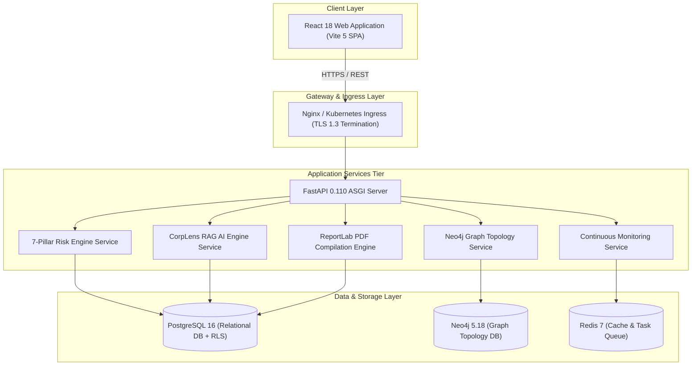
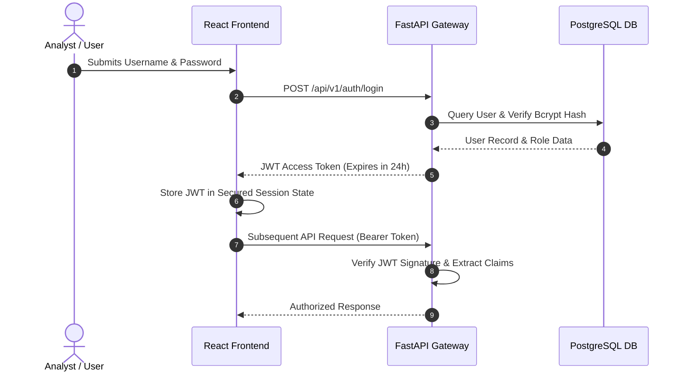
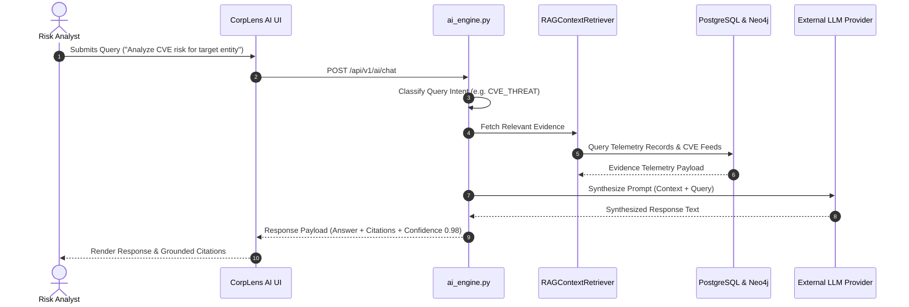

# 🏗️ CorpLens One — System Architecture Specification

> **Document Version**: 1.0.0  
> **Target Audience**: Systems Architects, Lead Engineers, DevOps Engineers, Security Reviewers  
> **Status**: Approved for Production Architecture  

---

## 1. Document Overview

### 1.1 Purpose
This document provides the formal architectural specification for **CorpLens One**. It details system components, data flows, communication patterns, security boundaries, storage topologies, and deployment configurations across presentation, application, and data layers.

### 1.2 Scope
This specification covers:
- Decoupled 3-tier system architecture and container topology.
- Authentication, authorization, and multi-tenant isolation mechanics.
- Data ingestion pipelines and 7-pillar risk calculation model.
- Retrieval-Augmented Generation (RAG) AI processing flow.
- High-availability, caching, and infrastructure scaling strategies.

---

## 2. High-Level System Architecture

CorpLens One utilizes a decoupled microservices architecture with stateless application services, persistent relational storage, graph relationship databases, and in-memory caches.

---

## 3. Core Component Specifications

### 3.1 Presentation Subsystem (`frontend/`)
- **Framework**: React 18.2 with TypeScript 5.2.
- **Build Tooling**: Vite 5.4.21 with ESBuild.
- **Routing**: React Router DOM v6 with route guard components for authentication state.
- **Visualization**: `Cytoscape.js` 3.28 for network graph rendering and `Recharts` 2.12 for metric charts.
- **Styling System**: Tailwind CSS v3 with custom HSL color tokens for light and dark UI themes.

### 3.2 Backend Subsystem (`backend/app/`)
- **API Framework**: FastAPI 0.110.0 running on asynchronous ASGI `Uvicorn` workers.
- **Data Access Layer**: SQLAlchemy 2.0 ORM with asynchronous connection pooling.
- **Authentication**: JWT tokens (HS256) with passlib password hashing (bcrypt).
- **Core Domain Services**:
  - `risk_engine.py`: Computes 7-pillar composite risk metrics ($0.0 - 10.0$) using normalized weights.
  - `ai_engine.py`: Handles intent classification, vector evidence retrieval (`RAGContextRetriever`), and multi-provider LLM execution (`LLMProviderWrapper`).
  - `graph_service.py`: Queries Neo4j graph nodes and generates Cytoscape-compatible JSON topologies.
  - `report_generator.py`: Generates ISO/IEC 27037 compliant binary PDF reports using ReportLab 4.5.

### 3.3 Storage & In-Memory Subsystems
- **PostgreSQL 16**: Relational storage for tenant companies, digital footprints, cases, tasks, and audit logs. Enforces Row-Level Security (RLS) policies per `tenant_id`.
- **Neo4j 5.18**: Graph database storing relationship nodes (`:Company`, `:Executive`, `:Technology`, `:CVE`, `:Supplier`).
- **Redis 7**: Key-value cache storing API query responses, rate-limiting tokens, and background worker queues.

---

## 4. End-to-End Data & Execution Workflows

### 4.1 Authentication & Authorization Flow

### 4.2 CorpLens AI (RAG Pipeline) Flow

---

## 5. Security & Isolation Architecture

1. **Multi-Tenant Isolation**: Enforced via PostgreSQL Row-Level Security (RLS) policies using `tenant_id` session settings (`backend/app/db/rls_policies.sql`).
2. **Cryptographic Chain of Custody**: All evidence ingested is hashed via SHA-256 and SHA-512 algorithms in compliance with **ISO/IEC 27037:2012**.
3. **Transport Security**: TLS 1.3 enforced for all external ingress and microservice communications.

---

## 6. System Scaling & Reliability

- **Stateless Application Nodes**: FastAPI containers maintain zero local state and scale horizontally behind a load balancer.
- **Database Connection Pooling**: Connection pool configured with `pool_size=10` and `max_overflow=20`.
- **Query Caching**: Heavy graph traversal queries are cached in Redis with a 300-second TTL.

---

## 7. Version & Compliance Information

- **Document Version**: 1.0.0
- **Author**: CorpLens One Software Architecture Team
- **License**: Enterprise Commercial License. See [LICENSE.md](LICENSE.md).
