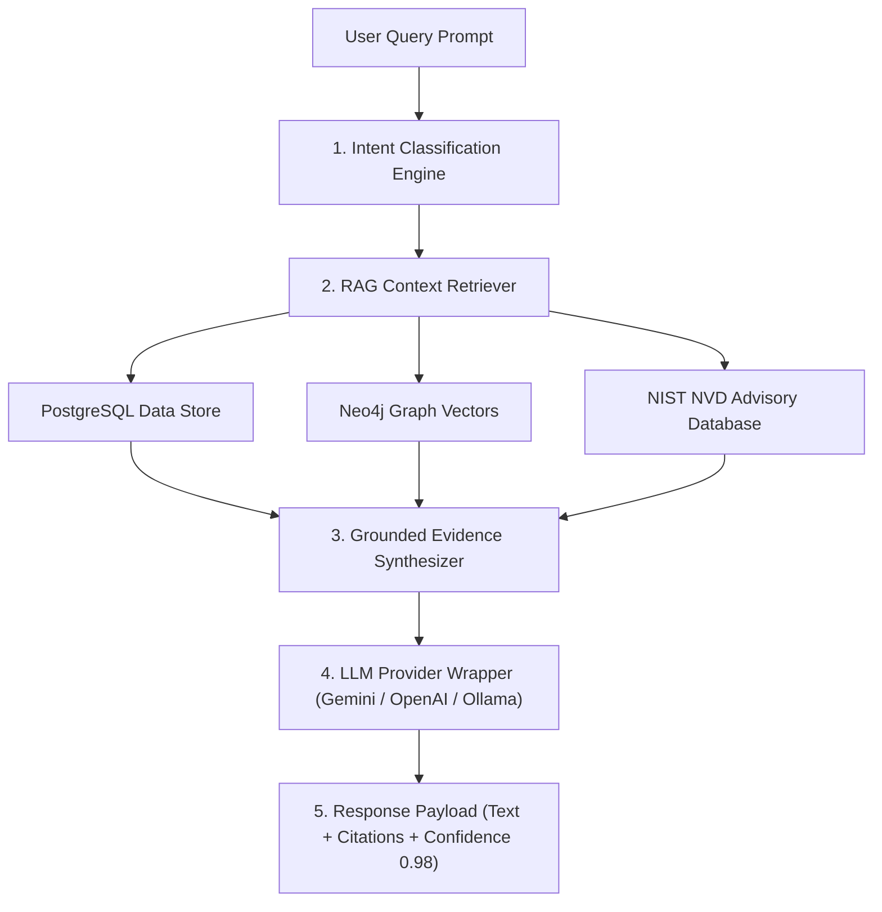

# 🤖 CorpLens AI — Module Architecture Specification

> **Document Version**: 1.0.0  
> **Parent System**: CorpLens One  
> **Module Purpose**: AI Copilot & Grounded RAG Risk Assistant  
> **Status**: Production Module Specification  

---

## 1. Executive Summary

**CorpLens AI** is the artificial intelligence copilot module integrated within the **CorpLens One** enterprise platform. It enables risk analysts, CISOs, and compliance teams to query complex corporate data, vulnerability feeds, and relationship topographies using natural language.

---

## 2. RAG Architecture & Ingestion Pipeline

CorpLens AI operates on a Retrieval-Augmented Generation (RAG) architecture (`backend/app/services/ai_engine.py`).



---

## 3. Supported Intent Categories

1. `COMPARE`: Differential risk matrix comparison between two corporate targets.
2. `EXECUTIVE`: Executive directory lookup, leadership risk flags, and corporate governance history.
3. `CVE_THREAT`: Active vulnerability advisory scan, CVSS severity ranking, and mitigation timelines.
4. `SANCTIONS`: OFAC SDN, UN, EU, and UK HMT sanctions matching and compliance adjudication.
5. `SUPPLY_CHAIN`: Multi-tier vendor concentration and 4th-party dependency trees.
6. `REPORT_GEN`: Automated compilation of executive compliance briefs.
7. `RISK_EXPLAIN`: Detailed mathematical breakdown of 7-pillar composite risk scores.

---

## 4. Evidence Citations & Grounding

To prevent hallucinations, CorpLens AI attaches structured citations to every response payload:

```json
{
  "answer": "Acme Global Financial Group maintains a Low Risk posture (28.5/100)...",
  "citations": [
    { "source": "SEC Form 10-K Filing 2026", "type": "Regulatory Filing" },
    { "source": "NIST NVD Advisory CVE-2023-38606", "type": "Vulnerability Database" },
    { "source": "US OFAC SDN Registry", "type": "Sanctions List" }
  ],
  "confidence_score": 0.98
}
```

---

## 5. Multi-Provider LLM Wrapper (`LLMProviderWrapper`)

The module features intelligent provider fallback routing:
1. **Primary**: Google Gemini 1.5 Pro API (`GEMINI_API_KEY`).
2. **Secondary**: OpenAI GPT-4o API (`OPENAI_API_KEY`).
3. **Local Fallback**: Local Ollama or deterministic rule engine.

---

## 6. Version & License Information

- **Document Version**: 1.0.0
- **Author**: CorpLens AI Engineering Group
- **License**: Enterprise Commercial License. See [LICENSE.md](LICENSE.md).
