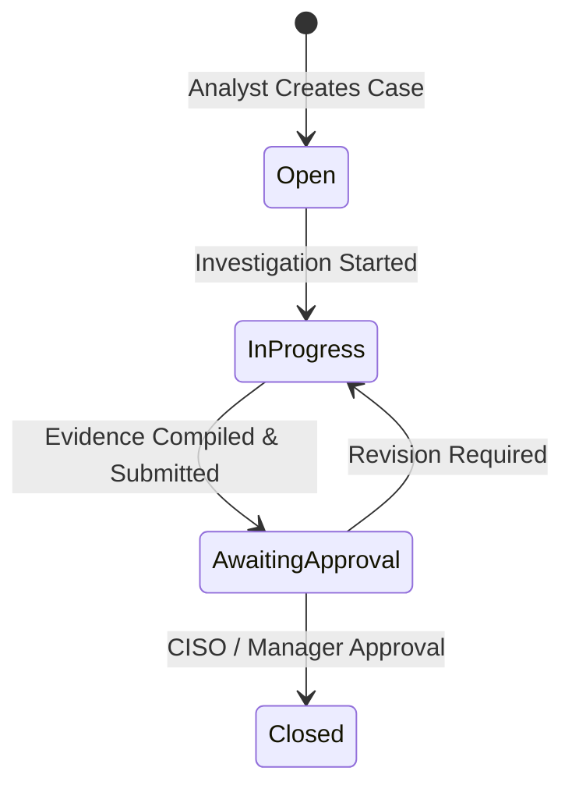

# 📋 Investigations Module — Architecture & Workflow Specification

> **Document Version**: 1.0.0  
> **Parent System**: CorpLens One  
> **Module Purpose**: Analyst Case Management & Task Tracking  
> **Status**: Production Module Specification  

---

## 1. Document Overview

### 1.1 Purpose
This document specifies the data model, lifecycle states, Kanban workflows, and task tracking mechanisms of the **Investigations** module in **CorpLens One**.

---

## 2. Case Lifecycle States

Cases transition through four strict operational states:



1. **Open**: Case initialized with target entity assignment and priority rating (`Low`, `Medium`, `High`, `Critical`).
2. **In Progress**: Analyst conducting active OSINT analysis, adding notes, and assigning sub-tasks.
3. **Awaiting Approval**: Investigation brief completed and submitted for manager/CISO review.
4. **Closed**: Investigation formally signed off and archived into immutable audit trail.

---

## 3. Case Data Model (`backend/app/models/domain_models.py`)

```python
class CaseModel(Base):
    __tablename__ = "cases"

    id = Column(String(64), primary_key=True)
    title = Column(String(255), nullable=False)
    target_company = Column(String(255), nullable=False)
    status = Column(String(32), default="Open")
    priority = Column(String(32), default="Medium")
    assigned_analyst = Column(String(255))
    created_at = Column(DateTime(timezone=True), default=datetime.utcnow)
    tenant_id = Column(String(64), nullable=False, index=True)
```

---

## 4. Sub-task & Activity Audit Trail

- **Task Items**: Checkbox items assigned to analysts with due dates and completion flags.
- **Analyst Notes**: Time-stamped text entries appended by security analysts.
- **Audit Logs**: Automatic logging of status transitions for SOC governance.

---

## 5. Version & License Information

- **Document Version**: 1.0.0
- **Author**: CorpLens One Product Engineering
- **License**: Enterprise Commercial License. See [LICENSE.md](LICENSE.md).
