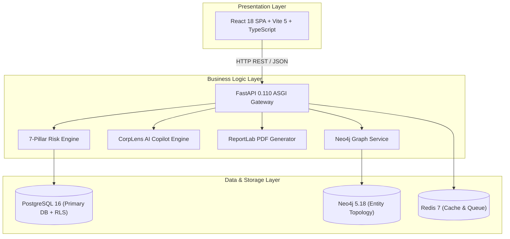

<div align="center">


# CorpLens One

### **The Operating System for Enterprise Intelligence**

[](https://github.com/amn2905/CorpLens-AI)
[](https://github.com/amn2905/CorpLens-AI)
[](https://www.python.org/)
[](https://fastapi.tiangolo.com/)
[](https://react.dev/)
[](https://www.typescriptlang.org/)
[](https://www.postgresql.org/)
[](#-isoiec-27037-evidentiary-chain-of-custody)

---

**CorpLens One** is a corporate intelligence platform that integrates public-source intelligence (OSINT), third-party risk management (TPRM), vulnerability tracking, sanctions compliance, and AI-assisted analysis into a unified enterprise application.

[Architecture](#-architecture-overview) • [Modules](#-platform-modules) • [Installation](#-installation) • [API Reference](API_REFERENCE.md) • [Documentation Directory](#-documentation-directory)

</div>

---

## 📌 Purpose & Scope

CorpLens One provides a unified operational surface for security analysts, risk officers, compliance teams, and legal auditors. The application ingests non-intrusive public telemetry (DNS records, SSL/TLS certificate transparency logs, web server response headers, NIST NVD advisories, and OFAC/UN/EU sanction registries) to calculate continuous corporate risk scores, map entity relationship topologies, manage investigation cases, and generate audited compliance reports.

---

## 🏗️ Architecture Overview

CorpLens One follows a decoupled microservices architecture with a React 18 single-page application (SPA), FastAPI ASGI services, PostgreSQL relational storage with Row-Level Security (RLS), Neo4j graph data, and Redis caching.



---

## 🛠️ Technology Stack

| Component | Technology | Version | Purpose |
| :--- | :--- | :--- | :--- |
| **Frontend UI** | React, TypeScript, Tailwind CSS | React 18.2, TS 5.2 | Web Application Interface |
| **Frontend Bundler** | Vite | 5.4.21 | Module Bundling & HMR |
| **Graph Visualizer** | Cytoscape.js | 3.28.1 | Entity Network Graph Rendering |
| **Backend Gateway** | FastAPI, Uvicorn | 0.110.0 | Asynchronous REST API Server |
| **Primary Relational DB** | PostgreSQL | 16.0 | Persistent Entity & Telemetry Storage |
| **Graph Database** | Neo4j | 5.18 | Corporate Network & Ownership Topology |
| **In-Memory Cache** | Redis | 7.0 | Query Caching & Task Dispatch |
| **PDF Engine** | ReportLab | 4.5.0 | ISO/IEC 27037 PDF Report Compilation |
| **Test Framework** | Pytest, FastAPI TestClient | Pytest 9.0 | Automated Backend Unit/Integration Testing |

---

## 📁 Repository Structure

```
CorpLens One (x:\CorpLens One)
├── backend/                  # FastAPI Microservices Application
│   ├── app/                  # Application Core (API, Services, Repositories, Schemas)
│   ├── tests/                # Pytest Automated Test Suite
│   ├── Dockerfile            # Container Definition for Backend
│   └── requirements.txt      # Python Package Dependencies
├── docs/                     # Detailed Architectural & Subsystem Documentation
│   ├── backend/              # Backend Subsystem Architecture Guides
│   └── frontend/             # Frontend Subsystem Architecture Guides
├── frontend/                 # React 18 / Vite Web Application
│   ├── src/                  # Components, Pages, Context, Hooks, Services
│   ├── index.html            # Main Entry Point Document
│   └── package.json          # Node Dependencies & Build Scripts
├── k8s/                      # Kubernetes Deployment & Service Manifests
├── API_REFERENCE.md          # REST API Specification
├── ARCHITECTURE_GUIDE.md     # System Architecture Blueprint
├── CHANGELOG.md              # Technical Release History
├── COMPLIANCE.md             # Compliance & Sanctions Module Specification
├── CONTRIBUTING.md           # Developer Contribution Guidelines
├── CORPLENS_AI.md            # CorpLens AI Module Specification
├── DATABASE_DESIGN.md        # Relational & Graph Database Specification
├── DEPLOYMENT_GUIDE.md       # Docker & Kubernetes Operational Guide
├── DEVELOPER_GUIDE.md        # Engineering Setup & Coding Standards
├── INVESTIGATIONS.md         # Investigation & Case Management Specification
├── KNOWLEDGE_GRAPH.md        # Neo4j Entity Topology Specification
├── LICENSE.md                # Enterprise License Agreement
├── REPORTING.md              # Evidence Report Engine Specification
├── SECURITY.md               # Security & Governance Specification
├── TESTING.md                # Automated Testing & Verification Guide
├── TPRM.md                   # Third-Party Risk Management Specification
└── docker-compose.yml        # Production Multi-Container Orchestration
```

---

## 📦 Installation & Setup

### Environment Variables
Copy `.env.example` to `.env` in the root workspace directory:

```env
PROJECT_NAME=CorpLens One
VERSION=1.0.0
POSTGRES_SERVER=db
POSTGRES_USER=postgres
POSTGRES_PASSWORD=postgrespassword
POSTGRES_DB=corplens_db
POSTGRES_PORT=5432
SECRET_KEY=corplens-super-secret-jwt-key-production-change-me
GEMINI_API_KEY=your_gemini_api_key_optional
OPENAI_API_KEY=your_openai_api_key_optional
```

### Option A: Docker Deployment (Recommended)
```bash
# Clone the repository
git clone https://github.com/amn2905/CorpLens-AI.git
cd CorpLens-AI

# Build and start all microservices
docker compose up --build -d

# Verify service availability
docker compose ps
```

Services will be accessible at:
- **Frontend UI**: [http://localhost:5173](http://localhost:5173)
- **Backend API**: [http://localhost:8000](http://localhost:8000)
- **OpenAPI Documentation**: [http://localhost:8000/docs](http://localhost:8000/docs)

### Option B: Local Developer Execution

#### 1. Backend Setup
```bash
cd backend
python -m venv venv
venv\Scripts\activate        # On Windows
# source venv/bin/activate   # On Linux/macOS

pip install -r requirements.txt
pytest                       # Execute backend unit test suite (22 tests)
python app/main.py
```

#### 2. Frontend Setup
```bash
cd frontend
npm install
npm run build                # Verify TypeScript compilation and Vite build
npm run dev                  # Start local Vite development server
```

---

## ⚡ Platform Modules

CorpLens One features 13 dedicated operational modules:
1. **Dashboard**: High-level corporate risk metrics, active alerts, and quick actions.
2. **Companies**: Target profile workspace detailing digital footprint, tech stack, CVEs, and reputation.
3. **CorpLens AI**: Grounded RAG AI copilot module providing natural language risk synthesis and evidence citations.
4. **Investigations**: Analyst case board with Kanban status tracking, task management, and activity logs.
5. **Compliance**: Sanctions screening against OFAC SDN, UN, EU, and UK HMT registries.
6. **Third Party Risk**: Vendor portfolio management, concentration metrics, and SLA tracking.
7. **Supply Chain**: Multi-tier dependency tree visualization and 4th-party concentration risk analysis.
8. **Threat Intelligence**: NIST NVD & CISA KEV vulnerability advisories correlation.
9. **Knowledge Graph**: Neo4j Cytoscape network graph explorer for entity relationship analysis.
10. **Monitoring**: Continuous domain change detection, certificate expiry alerts, and webhook notifications.
11. **Reports**: ISO/IEC 27037 PDF, HTML, CSV, and JSON evidentiary report generation.
12. **Settings**: Integration configurations, API key management, and webhook setup.
13. **Administration**: Enterprise user administration, RBAC role management, and audit log inspection.

---

## 📚 Documentation Directory

For in-depth technical documentation, refer to the following guides:
- [System Architecture Specification](ARCHITECTURE_GUIDE.md)
- [REST API Reference](API_REFERENCE.md)
- [Database & Graph Schema Design](DATABASE_DESIGN.md)
- [Deployment & Infrastructure Operations](DEPLOYMENT_GUIDE.md)
- [Security & Compliance Specification](SECURITY.md)
- [Developer & Engineering Setup Guide](DEVELOPER_GUIDE.md)
- [Testing Architecture Guide](TESTING.md)
- Subsystem Guides: [CorpLens AI](CORPLENS_AI.md) • [Investigations](INVESTIGATIONS.md) • [Compliance](COMPLIANCE.md) • [TPRM](TPRM.md) • [Knowledge Graph](KNOWLEDGE_GRAPH.md) • [Reporting](REPORTING.md)

---

## 🛡️ License & Attestation

Copyright © 2026 CorpLens One. All rights reserved.  
Distributed under the Enterprise Software License. See [LICENSE.md](LICENSE.md) for complete legal terms.
