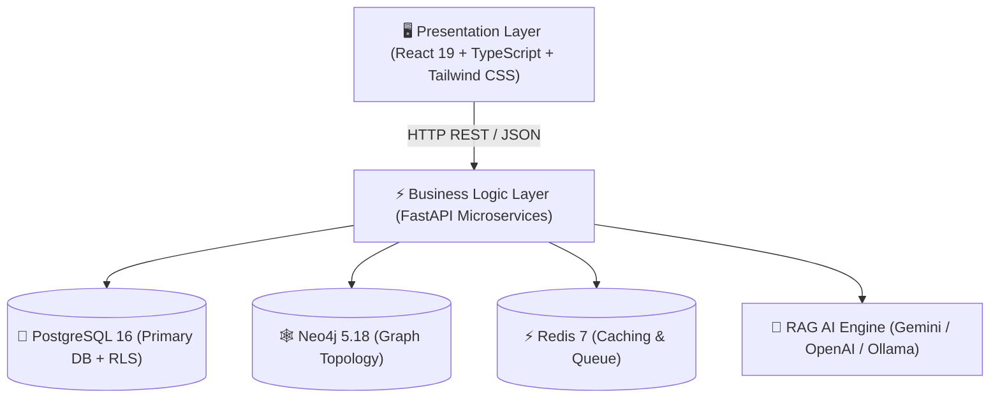

<div align="center">


# CorpLens One

### **AI-Powered Corporate Intelligence Platform**
***Smarter Intelligence. Better Decisions.***

[](https://github.com/amn2905/CorpLens-AI)
[](https://www.python.org/)
[](https://fastapi.tiangolo.com/)
[](https://react.dev/)
[](https://www.typescriptlang.org/)
[](https://www.postgresql.org/)
[](https://neo4j.com/)
[](https://www.docker.com/)
[](#-isoiec-27037-evidentiary-chain-of-custody)

---

**CorpLens One** is a world-class, enterprise-grade SaaS platform designed for **Chief Information Security Officers (CISOs), Corporate Risk Teams, M&A Advisors, Compliance Officers, and OSINT Analysts**.

It unifies passive Open Source Intelligence (OSINT), Third-Party Risk Management (TPRM), NIST Vulnerability advisories, OFAC/UN Sanction screening, Neo4j Graph Topology, and RAG AI Copilot into a single authoritative workspace.

[Quick Start](#-quick-start) • [Architecture](#-architecture) • [Core Capabilities](#-core-capabilities) • [API Endpoint Reference](#-api-endpoint-reference) • [Compliance](#-isoiec-27037-evidentiary-chain-of-custody)

</div>

---

## 💡 Executive Summary

CorpLens One solves the fragmentation of corporate intelligence by aggregating non-intrusive public telemetry, SEC filings, Certificate Transparency (CT) logs, global sanction watchlists, and software vulnerability feeds into a continuous 7-pillar risk calculation engine.

Key business outcomes delivered:
- **Zero-Intrusion Passive OSINT**: Conduct complete corporate reconnaissance without triggering target security alarms or violating scanning regulations.
- **Evidentiary Integrity**: Maintain an audited ISO/IEC 27037 Chain of Custody (CoC) with SHA-256 payload digests for board reporting and legal due diligence.
- **Domain-Grounded RAG AI**: Query corporate risk posture in natural language with direct citations from SEC 10-K filings, DNS records, and NIST advisories.

---

## ⚡ Core Capabilities

### 🏢 1. Target Intelligence Workspace & Passive Profiling
- **6-Pillar Deep-Dive Workspace**: Profile target organizations across Digital Footprint, Tech Stack, CVE Advisories, Public Documents, Regulatory News, and Executive Reputation.
- **Passive Ingestion Pipeline**: Ingest DNS records (A, MX, TXT, NS), SSL/TLS Certificate Transparency logs, HTTP headers, and public legal attestations without active port scans.

### 🤖 2. RAG AI Intelligence Copilot
- **3-Panel Forensic Interface**: Chat stream with grounded citations, session history navigation, and active evidence inspector drawer.
- **Multi-LLM Provider Wrapper**: Intelligent fallback routing supporting Google Gemini 1.5 Pro, OpenAI GPT-4o, and local Ollama models.
- **7 Intent Classifiers**: Auto-route queries across `COMPARE`, `EXECUTIVE`, `CVE_THREAT`, `SANCTIONS`, `REPORT_GEN`, `SUPPLY_CHAIN`, and `RISK_EXPLAIN`.

### 🕸️ 3. Neo4j Graph Topology & Entity Disambiguation
- **Visual Entity Mapping**: Interactive Cytoscape.js canvas visualizing connections between Parent Holding Companies, Subsidiaries, Board Executives, Shared Web Infrastructure, and Vulnerabilities.
- **Cypher Analytics**: Graph centrality metrics (Eigenvector & Betweenness) for identifying single points of failure in complex supply chains.

### 🛡️ 4. 7-Pillar Automated Risk Calculation Engine
Dynamically scores targets ($0.0 - 10.0$) across seven critical risk dimensions:
1. **Infrastructure Risk**: Open ports, SSL/TLS cert expiration, DNS misconfigurations.
2. **Technology Stack Risk**: Outdated web frameworks, unpatched software stacks.
3. **Reputation & News Risk**: Adverse media sentiment, regulatory actions.
4. **Business & Executive Risk**: Ownership turnover, governance anomalies.
5. **Operational Risk**: Provider outage history, single-point dependencies.
6. **Supply Chain Risk**: Multi-tier vendor concentration and 4th-party dependencies.
7. **Compliance & Sanctions Risk**: Fuzzy match scoring against US OFAC SDN, UN, EU, and UK HMT registries.

### ⚖️ 5. ISO/IEC 27037 Chain of Custody & PDF Report Engine
- **ReportLab 4.5 Binary Engine**: Generate multi-page executive PDF briefs featuring cryptographic SHA-256 / SHA-512 payload hashes, UTC timestamps, 7-pillar metric tables, and CISO sign-off signature blocks.
- **Multi-Format Exporting**: One-click exports for PDF, HTML, JSON, and CSV formats.

### 📋 6. Kanban Investigation Case Management
- **Analyst Case Board**: Drag-and-drop lifecycle management (`Open` → `In Progress` → `Resolved`).
- **Audit Trails**: Complete historical log of analyst notes, evidence additions, and task completions.

---

## 🏗️ Architecture

CorpLens One follows a 3-Tier Decoupled Microservices Architecture built for high availability and strict data isolation.



### Infrastructure Layering

```
┌─────────────────────────────────────────────────────────────────┐
│              CorpLens One Frontend (React 19 / Vite)            │
│  Tailwind CSS  ·  Lucide Icons  · Recharts  · Cytoscape.js     │
│  Enterprise Light Mode (#FFFFFF / #F8FAFC / #2563EB)            │
└────────────────────────────────┬────────────────────────────────┘
                                 │ HTTP REST (Port 8000)
                                 ▼
┌─────────────────────────────────────────────────────────────────┐
│               CorpLens One Backend (FastAPI Microservices)       │
│  12 Routers  ·  7-Pillar Risk Engine  · ReportLab PDF Generator │
└────────┬───────────────────────┬────────────────────────┬───────┘
         ▼                       ▼                        ▼
┌─────────────────┐     ┌─────────────────┐     ┌─────────────────┐
│  PostgreSQL 16  │     │   Neo4j 5.18    │     │     Redis 7     │
│  Primary Data   │     │  Graph Vectors  │     │  Queue / Cache  │
└─────────────────┘     └─────────────────┘     └─────────────────┘
```

---

## 🚀 Quick Start

### Option A: Running via Docker Compose (Recommended)

1. **Clone the Repository**:
   ```bash
   git clone https://github.com/amn2905/CorpLens-AI.git
   cd CorpLens-AI
   ```

2. **Launch Docker Stack**:
   ```bash
   docker compose up --build -d
   ```

3. **Access Services**:
   - 🖥️ **Frontend Interface**: [http://localhost:5173](http://localhost:5173)
   - ⚡ **Backend REST API**: [http://localhost:8000](http://localhost:8000)
   - 📜 **Interactive Swagger Docs**: [http://localhost:8000/docs](http://localhost:8000/docs)

---

### Option B: Local Developer Installation

#### Backend Setup
```bash
cd backend
python -m venv venv
venv\Scripts\activate      # Windows
# source venv/bin/activate # Linux/Mac

pip install -r requirements.txt
pytest -v                  # Run Backend Test Suite (22 Tests)
python app/main.py
```

#### Frontend Setup
```bash
cd frontend
npm install
npm run build              # Production build verification
npm run dev                # Launch Vite Dev Server
```

---

## 🔌 API Endpoint Reference

| Category | Endpoint | Method | Description |
| :--- | :--- | :---: | :--- |
| **System** | `/health` | `GET` | System health probe (DB, Neo4j, Redis status) |
| **Companies** | `/api/v1/companies` | `GET` | List monitored target companies |
| **Companies** | `/api/v1/companies/{id}` | `GET` | Get 360-degree target detail profile |
| **AI Copilot** | `/api/v1/ai/chat` | `POST` | RAG AI query endpoint with source citations |
| **CVE Intel** | `/api/v1/threats/cves` | `GET` | List NIST NVD vulnerability advisories |
| **Sanctions** | `/api/v1/sanctions/screen` | `POST` | Fuzzy name matching against OFAC/UN lists |
| **Cases** | `/api/v1/cases` | `GET / POST` | Analyst investigation case management |
| **Graph** | `/api/v1/graph/topology` | `GET` | Fetch Neo4j entity topology graph |
| **Reports** | `/api/v1/reports/pdf/{id}` | `GET` | Download ISO 27037 PDF evidentiary report |
| **STIX 2.1** | `/api/v1/export/stix` | `GET` | Export threat telemetry in STIX 2.1 JSON |

---

## 📜 ISO/IEC 27037 Evidentiary Chain of Custody

CorpLens One strictly adheres to **ISO/IEC 27037:2012** (*Guidelines for identification, collection, acquisition, and preservation of digital evidence*).

Every PDF brief generated by the platform includes:
- **Acquisition Timestamp**: UTC timestamped at collection.
- **SHA-256 Payload Hash**: Cryptographic verification digest of raw telemetry.
- **SHA-512 Verification**: High-entropy tamper checking.
- **Lawful OSINT Attestation**: Certified non-intrusive collection from public registries.

---

## 🛡️ License

Copyright © 2026 CorpLens One. All rights reserved.  
Distributed under the Proprietary Enterprise License. See `LICENSE` for full terms.
