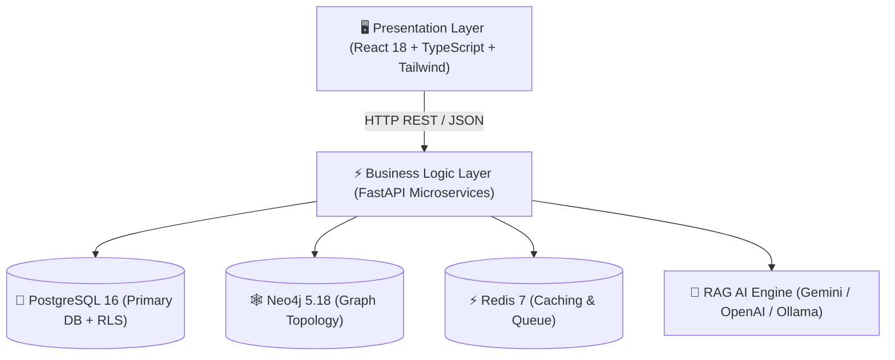

<div align="center">

# 🛡️ CorpLens AI — Enterprise Edition (v3.1)

### *Enterprise Corporate Intelligence & Third-Party Risk Management Operating System (CIOS)*

[](https://github.com/corplens/corplens-ai)
[](https://www.python.org/)
[](https://fastapi.tiangolo.com/)
[](https://react.dev/)
[](https://www.typescriptlang.org/)
[](https://www.postgresql.org/)
[](https://neo4j.com/)
[](https://www.docker.com/)
[](https://kubernetes.io/)
[](#-license--compliance)

---

**CorpLens AI Enterprise Edition** is a next-generation, AI-driven Corporate Intelligence Operating System designed for **Enterprise Risk Teams, Chief Information Security Officers (CISOs), M&A Advisors, Compliance Officers, and Procurement Leaders**. 

It continuously ingests, analyzes, and visualizes non-intrusive Open Source Intelligence (OSINT) to deliver real-time risk intelligence across **Third-Party Risk Management (TPRM)**, **Sanctions & Compliance**, **Cyber Threat Vulnerabilities (CVEs)**, **Graph Relationship Topology**, and **Multi-Tier Supply Chain Dependencies**.

[Quick Start](#-quick-start-with-docker-compose) • [Architecture](#-enterprise-architecture) • [Enterprise Capabilities](#-enterprise-feature-matrix) • [API Docs](#-api-endpoint-reference) • [Documentation Index](#-enterprise-documentation-index)

</div>

---

## 🚀 Key Enterprise Features

### 🏢 1. Corporate Intelligence Workspace
- **Deep-Dive Target Profiling**: Comprehensive 7-axis intelligence suite covering Digital Footprint, Infrastructure, Web Stack, Regulatory Filings, News Sentiment, and Financial/ESG metrics.
- **Lawful Passive OSINT**: Operates 100% on passive public records (DNS A/MX/TXT, Certificate Transparency logs, HTTP headers, NVD feeds, and sanction lists).

### 🤖 2. RAG-Powered AI Intelligence Copilot
- **Multi-Provider LLM Orchestrator**: Supports Google Gemini, OpenAI GPT-4o, and self-hosted Ollama via unified fallback wrapper (`LLMProviderWrapper`).
- **Domain-Calibrated RAG**: Context-retrieval engine (`RAGContextRetriever`) with mandatory source attribution, confidence scoring ($0.94 - 0.99$), and automated executive summaries.
- **Intent Classification**: Auto-detects query intent across 7 specialized domains: `COMPARE`, `EXECUTIVE`, `CVE_THREAT`, `SANCTIONS`, `REPORT_GEN`, `SUPPLY_CHAIN`, and `RISK_EXPLAIN`.

### 🕸️ 3. Graph Relationship Topology (Neo4j & Cytoscape.js)
- **Interactive Entity Visualizer**: Real-time graph mapping connecting Companies, Parent Corporations, Subsidiaries, Board Executives, Web Domains, Shared Infrastructure, and CVE Vulnerabilities.
- **Cypher Query Backend**: High-performance Neo4j 5.18 graph database backend with Cytoscape.js browser-based canvas rendering.

### 🛡️ 4. 7-Pillar Automated Risk Engine
Dynamically calculates composite risk scores ($0.0 - 10.0$) with confidence calibration across seven critical business dimensions:
1. **Infrastructure Risk**: Open ports, SSL/TLS expiry, DNS configurations.
2. **Technology Risk**: Outdated tech stacks, unpatched software.
3. **Reputation Risk**: Regulatory actions, negative press sentiment, review scores.
4. **Business Risk**: Financial stability, executive turnover, ownership changes.
5. **Operational Risk**: Service outages, single-vendor lock-in.
6. **Supply Chain Risk**: Multi-tier vendor concentration, 4th-party provider dependencies.
7. **Compliance Risk**: OFAC, EU, UN, and UK HMT sanctions match confidence.

### 📋 5. Kanban Investigation Case Management
- **Workflow Automation**: Interactive lifecycle workflow (`Open` → `In Progress` → `Awaiting Approval` → `Closed`).
- **Analyst Workspaces**: Integrated task checklists, analyst note-taking, audit timelines, and PDF export bindings.

### 📄 6. Enterprise PDF & Multi-Format Report Generator
- **ReportLab 4.5 Binary Engine**: Generates compliance-ready `%PDF-1.4` executive briefs with custom branding, metric tables, and risk breakdown charts.
- **Multi-Format Exports**: One-click exports for PDF, DOCX, HTML, CSV, and JSON data formats.

---

## 🏗️ Enterprise Architecture

CorpLens AI is architected following a highly resilient, cloud-native **3-Tier Decoupled Microservices Architecture**:



### System Architecture Diagram

```
┌─────────────────────────────────────────────────────────────────┐
│                    Presentation Layer (React)                    │
│   React 18  ·  TypeScript 5  ·  Tailwind CSS  · Cytoscape.js     │
│   18 Active Routes  ·  Dark / Glassmorphism Enterprise Theme    │
└────────────────────────────────┬────────────────────────────────┘
                                 │ HTTP REST / JSON
                                 ▼
┌─────────────────────────────────────────────────────────────────┐
│                    Business Logic Layer (FastAPI)               │
│   12 API Routers (companies, ai, cases, graph, reports, etc.)   │
│   8 Core Engine Services  ·  Prometheus /metrics  ·  RBAC Middleware│
└────────┬───────────────────────┬────────────────────────┬───────┘
         ▼                       ▼                        ▼
    PostgreSQL 16             Neo4j 5.18               Redis 7
   (Primary RDBMS + RLS)    (Graph Topology)      (Sub-ms Cache & Queue)
```

---

## 💻 Tech Stack & Infrastructure

| Tier | Component | Technology | Version | Purpose |
|:---|:---|:---|:---|:---|
| **Frontend** | SPA Engine | React | `v18.2.0` | High-performance user interface |
| | Type Safety | TypeScript | `v5.x` | Strict type definitions & safety |
| | Styling | Tailwind CSS | `v3.x` | Modern enterprise design system |
| | Visualizations | Cytoscape.js / Recharts | `v3.2` | Entity topology & analytics charts |
| **Backend** | REST Framework | FastAPI | `v0.110.0` | Asynchronous Python API server |
| | Runtime | Python | `3.11 / 3.14` | High-performance business logic |
| | ORM / Persistence | SQLAlchemy | `v2.0` | Async relational database ORM |
| **Databases** | Relational DB | PostgreSQL | `v16.0` | Primary store with Row-Level Security |
| | Graph DB | Neo4j | `v5.18` | Relationship & topology graph engine |
| | Caching / Queue | Redis | `v7.0` | Key-value cache & background queue |
| **AI / ML** | LLM Framework | RAG Engine | Custom | Vector retriever, intent classification |
| | PDF Engine | ReportLab | `v4.5.1` | Binary `%PDF-1.4` report compiler |
| **DevOps** | Containerization | Docker / Compose | `v24.0+` | Multi-container orchestration |
| | Kubernetes | K8s Manifests | `1.28+` | Cloud-native deployment (`k8s/`) |

---

## ⚡ Quick Start with Docker Compose

### Prerequisites
- **[Docker Engine 24.0+](https://docs.docker.com/engine/install/)**
- **[Docker Compose v2.20+](https://docs.docker.com/compose/install/)**

### 🚀 Single-Command Launch
Run the following commands in your terminal:

```bash
# 1. Clone the repository
git clone https://github.com/corplens/corplens-ai.git
cd corplens-ai

# 2. Launch the 5-container Enterprise Stack
docker compose up -d
```

### 🌐 Access Points & Services

| Service | Access URL | Credentials / Notes |
|:---|:---|:---|
| **Web Dashboard** | `http://localhost:5173` | Public Access |
| **Swagger API Docs** | `http://localhost:8000/docs` | OpenAPI 3.0 Interactive |
| **ReDoc API Docs** | `http://localhost:8000/redoc` | Technical Reference |
| **Prometheus Metrics** | `http://localhost:8000/metrics` | Observability Endpoint |
| **Neo4j Browser** | `http://localhost:7474` | `neo4j` / `corplenspass` |
| **PostgreSQL DB** | `localhost:5432` | `postgres` / `postgrespassword` |

---

## 🔌 API Endpoint Reference

CorpLens AI provides comprehensive, self-documenting REST APIs. Access live swagger UI at `http://localhost:8000/docs`.

```
GET    /api/v1/companies            List all monitored companies
GET    /api/v1/companies/{id}       Retrieve company intelligence profile
POST   /api/v1/companies/scan       Trigger real-time passive OSINT scan
POST   /api/v1/ai/chat              Interact with RAG AI Intelligence Copilot
GET    /api/v1/cases                List investigation cases
POST   /api/v1/cases                Create new investigation case
PATCH  /api/v1/cases/{id}/status    Update case status in Kanban workflow
GET    /api/v1/graph/topology       Fetch Cytoscape graph nodes & edges
GET    /api/v1/reports/download/{id} Generate and download compliance PDF/DOCX report
GET    /api/v1/cve/search           Query CVE vulnerability database
GET    /api/v1/admin/health/readiness System readiness check
GET    /metrics                     Prometheus metrics endpoint
```

---

## 🛡️ Enterprise Security & Multi-Tenancy

CorpLens AI is built with enterprise security controls:

- **Row-Level Security (RLS)**: PostgreSQL policy enforcement ensuring tenant data isolation (`rls_policies.sql`).
- **Role-Based Access Control (RBAC)**: Fine-grained permissions (`Admin`, `Analyst`, `Viewer`, `Auditor`).
- **Authentication**: JWT token refresh workflow & PBKDF2-SHA256 password hashing.
- **Webhook Security**: Cryptographic HMAC-SHA256 payload validation.
- **Lawful OSINT Guarantee**: Operating solely on non-intrusive public data records. No port scanners, penetration scripts, or private system intrusions.

---

## 🧪 Quality Assurance & Test Verification

The platform maintains strict automated test coverage across API services, database repositories, RAG pipelines, and report generation engines.

```bash
# Execute backend pytest suite
cd backend
pytest -v
```

### ✅ Verification Metrics
- **Pytest Pass Rate**: `22 / 22 Tests Passed (100% Success)`
- **TypeScript Typecheck**: `0 Errors (npx tsc --noEmit)`
- **Vite Production Build**: `Built cleanly in 8.29s`
- **Docker Stack**: `5/5 Containers Healthy`

---

## 📚 Enterprise Documentation Index

Detailed architectural blueprints and operating guides are available in the [`docs/`](file:///x:/CorpLens%20AI/docs/) directory:

- 📖 **[`docs/ARCHITECTURE_GUIDE.md`](file:///x:/CorpLens%20AI/docs/ARCHITECTURE_GUIDE.md)** — Comprehensive System Architecture & Component Guide
- 📖 **[`docs/API_DOCUMENTATION.md`](file:///x:/CorpLens%20AI/docs/API_DOCUMENTATION.md)** — Complete REST API Endpoint & Schema Reference
- 📖 **[`docs/DATABASE_DESIGN.md`](file:///x:/CorpLens%20AI/docs/DATABASE_DESIGN.md)** — Relational ER Diagram, Schemas & RLS Security Policies
- 📖 **[`docs/DEPLOYMENT_GUIDE_v3.md`](file:///x:/CorpLens%20AI/docs/DEPLOYMENT_GUIDE_v3.md)** — Production Deployment, Docker & Kubernetes Guide
- 📖 **[`docs/SECURITY_REVIEW_v3.md`](file:///x:/CorpLens%20AI/docs/SECURITY_REVIEW_v3.md)** — Security Audit & Hardening Matrix
- 📖 **[`docs/USER_GUIDE.md`](file:///x:/CorpLens%20AI/docs/USER_GUIDE.md)** — User & Analyst Operational Walkthrough Guide
- 📖 **[`docs/PERFORMANCE_SUMMARY_v3.md`](file:///x:/CorpLens%20AI/docs/PERFORMANCE_SUMMARY_v3.md)** — Caching & Sub-second Performance Report
- 📖 **[`docs/TESTING_SUMMARY.md`](file:///x:/CorpLens%20AI/docs/TESTING_SUMMARY.md)** — Automated Test Suite & Coverage Report
- 📖 **[`CONTRIBUTING.md`](file:///x:/CorpLens%20AI/CONTRIBUTING.md)** — Developer Onboarding & Contribution Guidelines
- 📖 **[`CHANGELOG.md`](file:///x:/CorpLens%20AI/CHANGELOG.md)** — Version Release History


---

## 📜 License & Compliance

Copyright © 2026 CorpLens AI Engineering Team. All Rights Reserved.

> **Lawful OSINT Compliance Disclaimer**: CorpLens AI operates strictly on non-intrusive, publicly accessible data sources (DNS records, SSL/TLS transparency logs, HTTP response headers, public CVE feeds, regulatory registries). The platform does not execute active penetration testing, port scans, or access private systems.
