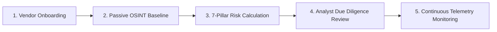

# 💼 Third-Party Risk Management (TPRM) Module — Specification

> **Document Version**: 1.0.0  
> **Parent System**: CorpLens One  
> **Module Purpose**: Vendor Risk Lifecycle, SLA Monitoring & Risk Scoring  
> **Status**: Production Module Specification  

---

## 1. Document Overview

### 1.1 Purpose
This document specifies the vendor risk evaluation model, concentration metrics, continuous monitoring algorithms, and SLA tracking capabilities of the **Third-Party Risk Management (TPRM)** module in **CorpLens One**.

---

## 2. Vendor Lifecycle Workflow

---

## 3. Vendor Risk Tier Categorization

Vendors are assigned risk tier designations based on composite scores ($0.0 - 10.0$):

| Composite Risk Score | Risk Tier Designation | Required Monitoring & SLA |
| :---: | :--- | :--- |
| **$0.0 - 3.9$** | **Low Risk** | Quarterly Automated Re-scan |
| **$4.0 - 6.9$** | **Medium Risk** | Monthly Automated Re-scan & Advisory |
| **$7.0 - 8.9$** | **High Risk** | Weekly Active Monitoring & Analyst Case |
| **$9.0 - 10.0$** | **Critical Risk** | Continuous Daily Alerting & Executive Sign-off |

---

## 4. Vendor SLA & Uptime Telemetry

The continuous monitoring engine (`backend/app/services/monitoring_engine.py`) tracks:
- DNS endpoint availability and response latencies.
- SSL/TLS certificate expiration windows ($< 30$ Days triggers warning).
- HTTP response security headers.

---

## 5. Version & License Information

- **Document Version**: 1.0.0
- **Author**: CorpLens One TPRM Engineering Group
- **License**: Enterprise Commercial License. See [LICENSE.md](LICENSE.md).
