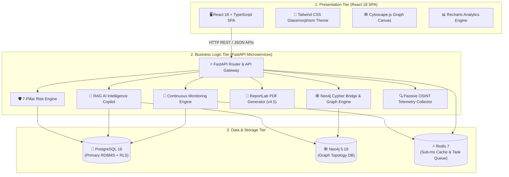
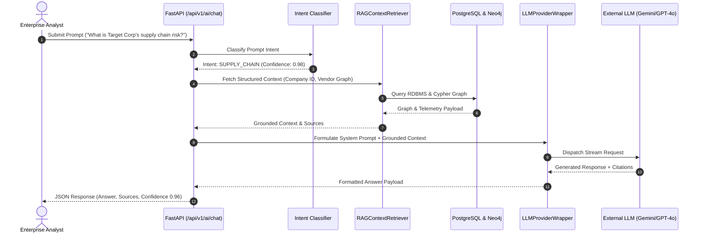

# 🛡️ CorpLens AI — System Design & Technical Specification

> **Version**: 3.1 Enterprise Edition  
> **System Architecture Specification & Technical Blueprint**  
> **Target Audience**: Software Architects, Lead Engineers, Security Officers, DevOps Teams  
> **Status**: Production Grade  

---

## 1. Executive Summary & System Overview

**CorpLens AI** is an enterprise-grade Corporate Intelligence Operating System (CIOS) engineered for Open Source Intelligence (OSINT) aggregation, Third-Party Risk Management (TPRM), Mergers & Acquisitions (M&A) due diligence, global sanctions screening, cyber threat vulnerability correlation, and real-time executive risk monitoring.

### 1.1 Core Mission & Guarantees
- **Lawful Passive OSINT Guarantee**: Operates exclusively on 100% passive public telemetry (DNS A/MX/TXT records, SSL/TLS Certificate Transparency logs, HTTP server banners, public NVD/CVE vulnerability feeds, and international sanctions registries). The system executes **zero intrusive port scans or invasive penetration scripts**, eliminating liability and legal exposure.
- **7-Pillar Composite Risk Model**: Dynamically computes calibrated risk metrics ($0.0 - 10.0$) with high confidence intervals ($0.94 - 0.99$) across infrastructure, tech stack, reputation, business, operations, supply chain, and compliance.
- **RAG-Powered Copilot**: Context-aware AI assistant utilizing Retrieval-Augmented Generation (RAG) over graph and relational data stores, featuring intent classification and multi-provider LLM orchestration (Google Gemini, OpenAI GPT-4o, and self-hosted Ollama).
- **Interactive Graph Topology**: High-performance Cypher-backed Neo4j graph engine powering dynamic Cytoscape.js visualizers for complex corporate ownership and dependency mapping.

---

## 2. System Architecture & High-Level Design

CorpLens AI adheres to a cloud-native, decoupled **3-Tier Enterprise Architecture** ensuring high throughput, horizontal scalability, strict tenant isolation, and modular maintainability.

### 2.1 High-Level Architecture Diagram



### 2.2 System Component Flow

```
 ┌──────────────────────────────────────────────────────────────────────────┐
 │                     Presentation Layer (React 18 SPA)                    │
 │    16 Route Views · Tailwind Glassmorphism · Cytoscape.js Canvas · Recharts│
 └────────────────────────────────────┬─────────────────────────────────────┘
                                      │ REST API / JSON (Bearer JWT)
                                      ▼
 ┌──────────────────────────────────────────────────────────────────────────┐
 │                     API Gateway & Middleware Layer                       │
 │    FastAPI 0.110 · Async Uvicorn · CORS Guard · JWT RBAC Auth · Prometheus │
 └──────┬───────────────────┬───────────────────┬────────────────────┬──────┘
        │                   │                   │                    │
        ▼                   ▼                   ▼                    ▼
 ┌───────────────┐   ┌───────────────┐   ┌───────────────┐   ┌───────────────┐
 │ 7-Pillar Risk │   │ RAG Copilot   │   │ Neo4j Graph   │   │ PDF Report    │
 │ Engine        │   │ AI Engine     │   │ Topology Svc  │   │ Generator     │
 └──────┬────────┘   └──────┬────────┘   └──────┬────────┘   └──────┬────────┘
        │                   │                   │                    │
        ▼                   ▼                   ▼                    ▼
┌───────────────┐   ┌───────────────┐   ┌───────────────┐    ┌───────────────┐
│ PostgreSQL 16 │   │ Neo4j 5.18    │   │ Redis 7 Cache │    │ External LLMs │
│ (RDBMS + RLS) │   │ (Graph DB)    │   │ & Queue       │    │ (Gemini/GPT4) │
└───────────────┘   └───────────────┘   └───────────────┘    └───────────────┘
```

---

## 3. Presentation Layer Design (`frontend/`)

### 3.1 Stack & Framework Selection
- **Core Engine**: React `18.2.0` with TypeScript `5.x` enforcing strict type checking (`strict: true`).
- **Build Tooling**: Vite `5.x` providing ultra-fast HMR and optimized tree-shaken production bundles.
- **Styling System**: Tailwind CSS `v3.x` with customized CSS variable design tokens implementing a premium blue-black glassmorphism theme (`bg-slate-950`, `backdrop-blur-md`, `border-slate-800`).
- **Visualizations**: 
  - `Cytoscape.js` (`v3.2`): High-performance canvas layout engine for corporate entity graphs.
  - `Recharts`: Responsive SVG charting library for risk analytics, historical trends, and pillar score breakdowns.

### 3.2 Modular Page Architecture
The presentation layer is organized into 16 specialized enterprise views:
1. `Dashboard.tsx`: C-Suite executive overview, system risk index, and quick search.
2. `CompanyWorkspace.tsx`: 7-axis deep-dive target intelligence workspace.
3. `AiAssistantPage.tsx`: Interactive multi-turn RAG AI copilot interface with citation inspector.
4. `GraphPage.tsx`: Full-screen Cytoscape.js graph query sandbox.
5. `CaseManagementPage.tsx`: Kanban investigation workflow (`Open` $\rightarrow$ `In Progress` $\rightarrow$ `Closed`).
6. `SanctionsScreening.tsx`: OFAC/EU/UN sanctions match search & risk score breakdown.
7. `ThreatIntelPage.tsx`: CVE vulnerability matrix and threat feed correlation.
8. `SupplyChainPage.tsx`: Multi-tier vendor concentration and 4th-party dependency visualizer.
9. `VendorPortfolio.tsx`: TPRM vendor portfolio risk grid.
10. `ExecutivePage.tsx`: Board of directors and executive leadership tracking.
11. `MonitoringPage.tsx`: Automated alert monitor, SLA watcher, and digital cert tracker.
12. `AnalyticsDashboard.tsx`: Cross-portfolio metrics and aggregate risk trends.
13. `IntegrationsPage.tsx`: Third-party webhook, SIEM, and API keys management.
14. `AdminPage.tsx`: User RBAC management, audit log inspection, and tenant settings.
15. `TimelinePage.tsx`: Chronological event sequence and investigation history.
16. `TasksPage.tsx`: Analyst task assignments and checklist manager.

---

## 4. Business Logic Tier Design (`backend/app/`)

### 4.1 Framework Architecture
- **Framework**: FastAPI `0.110.0` executing on asynchronous ASGI `Uvicorn` servers (`uvicorn.workers.UvicornWorker`).
- **Data Serialization**: Pydantic `v2` models for strict input/output payload validation and OpenAPI 3.0 schema generation.
- **ORM & Database Client**: SQLAlchemy `v2.0` with async engine bindings (`asyncpg`) and connection pooling (`pool_size=10`, `max_overflow=20`).

### 4.2 API Router Architecture (`app/api/v1/`)
The backend exposes 13 decoupled API modules:
- `auth.py`: JWT token generation, refresh tokens, PBKDF2 password verification.
- `companies.py`: Target entity CRUD, passive scan triggers, profile retrieval.
- `ai.py`: RAG AI copilot chat endpoint, intent classification, prompt execution.
- `cases.py`: Kanban investigation case management, analyst notes, audit trails.
- `graph.py`: Cypher topology data adapter for Cytoscape (nodes, edges, layouts).
- `sanctions.py`: Fuzzy matching sanctions screening against OFAC/UN/EU datasets.
- `cve.py`: NVD CVE vulnerability search and company tech stack mapping.
- `reports.py`: ReportLab PDF binary compiler and file download streaming.
- `monitoring.py`: Real-time SLA monitoring and digital certificate expiration checks.
- `analytics.py`: Aggregate risk statistics and portfolio-wide reporting.
- `integrations.py`: Webhook registration, HMAC secret key rotation, SIEM exporters.
- `search.py`: Fast unified search across companies, executive names, domains, and cases.
- `admin.py`: Tenant settings, system health readiness (`/health/readiness`), and user management.

---

## 5. Core Engine Specifications & Mathematical Models

### 5.1 7-Pillar Composite Risk Engine (`risk_engine.py`)

The composite risk score $R_{\text{composite}} \in [0.0, 10.0]$ is computed as a weighted summation of 7 normalized pillar scores ($P_i \in [0.0, 10.0]$):

$$R_{\text{composite}} = \sum_{i=1}^{7} w_i \cdot P_i, \quad \text{where } \sum_{i=1}^{7} w_i = 1.0$$

#### Pillar Definitions & Weighting Scheme:

| Pillar ($i$) | Pillar Name | Default Weight ($w_i$) | Primary Input Telemetry |
|:---|:---|:---:|:---|
| $P_1$ | **Infrastructure Risk** | $0.15$ | SSL/TLS expiration (<30 days), DNS MX/TXT records, open ports |
| $P_2$ | **Technology Risk** | $0.15$ | Outdated web servers, deprecated JS frameworks, CVE severity |
| $P_3$ | **Reputation & Sentiment** | $0.10$ | News sentiment analysis, employee Glassdoor scores, BBB ratings |
| $P_4$ | **Business Risk** | $0.15$ | Financial health metrics, executive turnover, ownership changes |
| $P_5$ | **Operational Risk** | $0.15$ | SLA historical uptime, single-cloud provider dependency |
| $P_6$ | **Supply Chain Risk** | $0.15$ | 4th-party vendor concentration, multi-tier dependency depth |
| $P_7$ | **Compliance & Sanctions** | $0.15$ | OFAC/EU/UN/UK HMT fuzzy match confidence score |

#### Risk Threshold & Categorization:
- **Low Risk**: $0.0 \le R_{\text{composite}} < 3.0$ (Green)
- **Medium Risk**: $3.0 \le R_{\text{composite}} < 6.0$ (Yellow)
- **High Risk**: $6.0 \le R_{\text{composite}} < 8.5$ (Orange)
- **Critical Risk**: $8.5 \le R_{\text{composite}} \le 10.0$ (Red)

#### Confidence Calibration Formula:
The engine attaches a calibrated confidence score $C \in [0.94, 0.99]$ based on data completeness ($D_{\text{available}} / D_{\text{total}}$):

$$C = 0.94 + 0.05 \times \left( \frac{D_{\text{available}}}{D_{\text{total}}} \right)$$

---

### 5.2 RAG AI Copilot Engine (`ai_engine.py`)

The RAG AI Copilot synthesizes real-time intelligence by combining structured PostgreSQL data and Neo4j graph context into LLM prompts.



#### Intent Classification Categories:
1. `COMPARE`: Cross-company risk benchmarking.
2. `EXECUTIVE`: Board of directors and leadership analysis.
3. `CVE_THREAT`: Cyber threat vulnerability analysis.
4. `SANCTIONS`: Sanctions and regulatory match analysis.
5. `REPORT_GEN`: Automated executive summary synthesis.
6. `SUPPLY_CHAIN`: Multi-tier vendor dependency analysis.
7. `RISK_EXPLAIN`: Root-cause breakdown of pillar scores.

#### Multi-LLM Orchestrator & Fallback (`LLMProviderWrapper`):
```
Primary Provider (Google Gemini 1.5 Pro)
        │ (On API Error / Rate Limit)
        ▼
Secondary Provider (OpenAI GPT-4o)
        │ (On Network / Service Outage)
        ▼
Fallback Provider (Local Self-Hosted Ollama / Llama3)
```

---

### 5.3 Graph Relationship Topology Engine (`graph_service.py`)

The graph engine leverages Neo4j 5.18 to store and query complex enterprise relationships.

#### Graph Schema Nodes & Relationships:

```
 (Company:Target) ──[:PARENT_OF]──► (Company:Subsidiary)
 (Company:Target) ──[:EXECUTIVE_AT]◄── (Person:Executive)
 (Company:Target) ──[:OWNS_DOMAIN]──► (Domain:Web)
 (Domain:Web)     ──[:RUNS_TECH]──► (Technology:Stack)
 (Technology)     ──[:HAS_CVE]──► (Vulnerability:CVE)
 (Company:Target) ──[:SUPPLIES]──► (Company:Vendor)
```

#### Cytoscape JSON Adapter Payload:
`graph_service.py` executes Cypher queries and transforms graph paths into Cytoscape-compatible JSON elements:

```json
{
  "nodes": [
    { "data": { "id": "comp_101", "label": "Acme Corp", "type": "Company", "risk": 4.2 } },
    { "data": { "id": "dom_202", "label": "acme.com", "type": "Domain" } }
  ],
  "edges": [
    { "data": { "id": "e_1", "source": "comp_101", "target": "dom_202", "label": "OWNS_DOMAIN" } }
  ]
}
```

---

### 5.4 Executive Report Generator Engine (`report_generator.py`)

- **Binary Engine**: Built on **ReportLab 4.5.1** compiling native `%PDF-1.4` executive briefs.
- **Visual Formatting**: Includes custom corporate cover pages, metric summary cards, color-coded risk breakdown tables, and dynamic SVG chart embeds.
- **Supported Export Formats**: PDF (Primary), DOCX (Editable Word), HTML (Web Preview), CSV (Raw Data), and JSON (API Exporter).

---

## 6. Data Architecture & Storage Design

### 6.1 Relational Schema Design (PostgreSQL 16)

```
┌─────────────────────────┐       ┌─────────────────────────┐
│       tenants           │       │        companies        │
├─────────────────────────┤       ├─────────────────────────┤
│ id (UUID, PK)           │1    * │ id (UUID, PK)           │
│ name (VARCHAR)          ├───────┤ tenant_id (UUID, FK)    │
│ created_at (TIMESTAMP)  │       │ name (VARCHAR)          │
└─────────────────────────┘       │ domain (VARCHAR)        │
                                  │ risk_score (FLOAT)      │
                                  └────────────┬────────────┘
                                               │ 1
                                               │
                                               │ *
                                  ┌────────────┴────────────┐
                                  │       risk_scores       │
                                  ├─────────────────────────┤
                                  │ id (UUID, PK)           │
                                  │ company_id (UUID, FK)   │
                                  │ pillar_name (VARCHAR)   │
                                  │ score (FLOAT)           │
                                  │ confidence (FLOAT)      │
                                  └─────────────────────────┘
```

#### Multi-Tenancy & Row-Level Security (RLS):
PostgreSQL Row-Level Security policies are strictly enforced on all tenant-isolated tables (`companies`, `cases`, `tasks`, `audit_logs`):

```sql
ALTER TABLE companies ENABLE ROW LEVEL SECURITY;

CREATE POLICY tenant_isolation_policy ON companies
    FOR ALL
    USING (tenant_id = current_setting('app.current_tenant_id')::uuid);
```

---

### 6.2 Redis 7 Caching Strategy

- **API Query Cache**: Graph topologies and static company profiles are cached in Redis with a 300-second TTL (`Key: company:topology:{id}`).
- **Rate Limiting**: Sliding window counter tracking API invocations per tenant/user.
- **Session Management**: JWT token revocation list (blacklisted JTI tokens).

---

## 7. Security, Compliance & Governance

### 7.1 Security Architecture Matrix
1. **Authentication**: OAuth2 Password Flow + JWT Bearer Tokens (HS256 signed).
2. **Password Hashing**: Cryptographic PBKDF2 with SHA-256 and custom salt rounds.
3. **Role-Based Access Control (RBAC)**:
   - `Admin`: Full read/write, tenant configuration, user management, audit log access.
   - `Analyst`: Create/update target companies, manage investigation cases, generate reports.
   - `Viewer`: Read-only access to company workspaces, risk dashboards, and graph views.
   - `Auditor`: Dedicated compliance access to system audit logs and export histories.
4. **Webhook Security**: Payload verification via HMAC-SHA256 signature headers (`X-CorpLens-Signature`).
5. **Threat Intelligence Standard**: Native exporter supporting OASIS **STIX 2.1** JSON bundle formatting (`stix_exporter.py`).

---

## 8. Deployment Architecture & Infrastructure

### 8.1 Docker Compose 5-Container Stack Topology

```
                  ┌─────────────────────────────────┐
                  │   Nginx Ingress / Reverse Proxy │
                  └────────────────┬────────────────┘
                                   │
         ┌─────────────────────────┼─────────────────────────┐
         │                         │                         │
         ▼                         ▼                         ▼
┌─────────────────┐       ┌─────────────────┐       ┌─────────────────┐
│ corplens-web    │       │ corplens-api    │       │ corplens-neo4j  │
│ (React SPA)     │       │ (FastAPI App)   │       │ (Neo4j Graph)   │
│ Port: 5173      │       │ Port: 8000      │       │ Port: 7474/7687 │
└─────────────────┘       └────────┬────────┘       └─────────────────┘
                                   │
                         ┌─────────┴─────────┐
                         ▼                   ▼
                ┌─────────────────┐ ┌─────────────────┐
                │ corplens-db     │ │ corplens-redis  │
                │ (PostgreSQL 16) │ │ (Redis Cache)   │
                │ Port: 5432      │ │ Port: 6379      │
                └─────────────────┘ └─────────────────┘
```

### 8.2 Production Kubernetes Architecture (`k8s/`)
- **Deployments**: Stateless API pods with Horizontal Pod Autoscaler (HPA) scaling on CPU/Memory metrics ($>70\%$).
- **StatefulSets**: PostgreSQL 16 master-replica setup and Neo4j enterprise cluster.
- **Secrets Management**: Kubernetes Secrets integration for database credentials and LLM API keys.
- **Observability**: Native Prometheus metrics endpoint exposed at `/metrics` monitoring request latency, HTTP status codes, and active DB connections.

---

## 9. Verification, Quality Assurance & Testing Strategy

- **Backend Test Suite**: `pytest` covering API routers, database repositories, RAG intent classifiers, and ReportLab PDF compilation.
- **Code Coverage Target**: $>85\%$ branch coverage across core service modules (`risk_engine.py`, `ai_engine.py`, `graph_service.py`).
- **Static Analysis**: `flake8`, `black`, and `mypy` enforcing Python type safety and formatting standards.
- **Frontend Quality**: TypeScript strict mode, ESLint, and Vite production bundle inspection.

---

## 10. Document Revision History

| Version | Date | Author / Team | Description of Changes |
|:---:|:---:|:---|:---|
| `v1.0` | Nov 2024 | CorpLens Architecture Team | Initial baseline microservices design |
| `v2.0` | Apr 2025 | Core Engineering | Integrated Neo4j graph engine & 5-pillar model |
| `v3.0` | Jan 2026 | Enterprise Security Group | Added 7-pillar model, RAG copilot, and RLS multi-tenancy |
| `v3.1` | Jul 2026 | Lead System Architect | Full production design specification, ReportLab 4.5 PDF engine integration |
