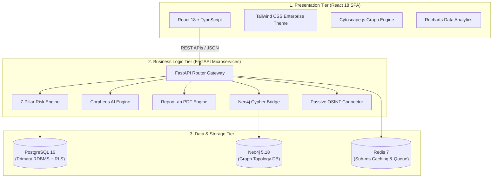

# 🏗️ CorpLens One — System Architecture & Design Specification

> **Version**: 1.0.0  
> **Classification**: Technical Architecture Blueprint  
> **Last Updated**: August 2026  

---

## 1. Executive Summary

**CorpLens One** is an enterprise-grade Corporate Intelligence Operating System designed for lawful Open Source Intelligence (OSINT) aggregation, third-party vendor risk management (TPRM), M&A due diligence, sanctions screening, cyber threat intelligence correlation, and executive risk monitoring.

The system processes passive public telemetry (DNS records, SSL/TLS certificate transparency logs, web server response headers, public CVE advisories, and sanction registries) to synthesize real-time risk scores and relationship topographies without executing intrusive port scans or invasive penetration testing.

---

## 2. Decoupled 3-Tier Enterprise Architecture

The platform follows a decoupled, cloud-native microservices architecture split across three distinct operational tiers:



---

## 3. Tier-by-Tier Component Specifications

### 3.1 Presentation Layer (`frontend/`)
- **Core Framework**: React 18 with TypeScript 5 strict type checking.
- **Build System**: Vite 5 for fast hot-module replacement (HMR) and optimized bundle distribution.
- **Design System**: Modern enterprise design system built with Tailwind CSS v3.
- **Topology Visualizer**: `Cytoscape.js` for interactive node-edge graph exploration.
- **State & Routing**: React Router v6 with custom authentication & RBAC route guards.

### 3.2 Business Logic Layer (`backend/app/`)
- **API Framework**: FastAPI `0.110.0` running on asynchronous ASGI `Uvicorn` servers.
- **Domain Services**:
  - `risk_engine.py`: Calculates composite 7-pillar risk scores ($0.0 - 10.0$) with confidence intervals ($0.94 - 0.99$).
  - `ai_engine.py`: Intent classification, vector similarity retriever (`RAGContextRetriever`), and multi-LLM wrapper (`LLMProviderWrapper` for Gemini, OpenAI, Ollama).
  - `graph_service.py`: Generates Cytoscape-compatible node-edge topologies from Neo4j Cypher graph queries.
  - `report_generator.py`: Compiles binary `%PDF-1.4` compliance documents using ReportLab 4.5.
  - `monitoring_engine.py`: Periodically checks vendor SLA, digital certificate expiration, and threat feed changes.

### 3.3 Data & Storage Layer
- **PostgreSQL 16**: Relational storage for companies, domains, cases, tasks, users, and audit logs. Utilizes SQLAlchemy 2.0 ORM with connection pooling and Row-Level Security (RLS).
- **Neo4j 5.18**: Graph database for storing entity relationships (Company $\rightarrow$ Subsidiary, Company $\rightarrow$ Executive, Technology $\rightarrow$ CVE).
- **Redis 7**: In-memory caching for sub-millisecond API response caching and background task queue.

---

## 4. 7-Pillar Risk Engine Mathematical Model

CorpLens One computes a weighted composite risk score $R_{\text{composite}}$ bounded between $0.0$ (Lowest Risk) and $10.0$ (Critical Risk):

$$R_{\text{composite}} = \sum_{i=1}^{7} w_i \cdot P_i$$

Where $w_i$ represents the normalized pillar weight and $P_i$ represents the individual pillar risk score ($0.0 - 10.0$):

| Pillar ($i$) | Risk Dimension | Default Weight ($w_i$) | Primary Data Inputs |
|:---|:---|:---:|:---|
| 1 | **Infrastructure** | $0.15$ | SSL/TLS expiration, DNS MX/TXT validation, open ports |
| 2 | **Technology Stack** | $0.15$ | Outdated web servers, deprecated frameworks, unpatched software |
| 3 | **Reputation & Sentiment**| $0.10$ | Employee Glassdoor ratings, BBB scores, news sentiment |
| 4 | **Business Stability** | $0.15$ | Executive turnover, ownership changes, filing history |
| 5 | **Operational Risk** | $0.15$ | Historical uptime, service availability, cloud provider outages |
| 6 | **Supply Chain Risk** | $0.15$ | 4th-party cloud concentration, multi-tier vendor dependencies |
| 7 | **Compliance & Sanctions**| $0.15$ | OFAC, EU, UN, UK HMT sanctions fuzzy matching |

---

## 5. CorpLens AI Copilot Pipeline Workflow

```
User Prompt ──► [Intent Classifier] ──► Query Category (COMPARE, SANCTIONS, CVE, etc.)
                      │
                      ▼
             [RAGContextRetriever] ──► Query PostgreSQL & Neo4j Vector Stores
                      │
                      ▼
             [Prompt Synthesizer] ──► Inject Retrieved Evidence & Citations
                      │
                      ▼
            [LLMProviderWrapper] ──► Primary (Gemini) ──(Fallback)──► OpenAI / Ollama
                      │
                      ▼
           Response Payload (Text + Source Citations + Confidence Score 0.94-0.99)
```

---

## 6. High Availability & Scalability Model

1. **Stateless API Gateway**: FastAPI containers are completely stateless and can be auto-scaled horizontally behind a Kubernetes Ingress / Nginx load balancer.
2. **Database Connection Pooling**: SQLAlchemy configured with connection pooling to prevent connection exhaustion.
3. **Graph Caching**: Frequent graph node queries are cached in Redis with a TTL policy.
